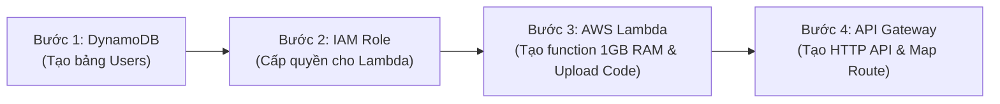

# Hướng Dẫn Toàn Tập: AWS Lambda + DynamoDB + API Gateway (Buổi 12 + 13)

Tài liệu này bao gồm 2 phần:
1. **Hướng dẫn từng bước thực hành trên giao diện AWS Console (Trực quan cho học viên)**.
2. **Tổng hợp toàn bộ các câu lệnh AWS CLI đã thực thi tự động (Dành cho DevOps Automation)**.

---

# PHẦN 1: HƯỚNG DẪN THỰC HÀNH TỪNG BƯỚC TRÊN AWS CONSOLE

Toàn bộ bài tập gồm 4 bước lớn trên giao diện AWS Console (chọn Region: **Asia Pacific (Sydney) `ap-southeast-2`**):



---

### BƯỚC 1: TẠO BẢNG DYNAMODB & DỮ LIỆU MẪU

1. Trên ô tìm kiếm AWS, gõ **DynamoDB** và bấm chọn.
2. Bấm nút màu cam **Create table**:
   - **Table name**: `Users`
   - **Partition key**: gõ `userId`, kiểu dữ liệu chọn `String`.
   - Mục **Table settings**: Chọn **Customize settings** $\rightarrow$ chọn **On-demand** (để chỉ trả tiền theo lượt đọc/ghi thực tế, không tốn chi phí duy trì cố định).
   - Bấm **Create table** ở cuối trang.
3. **Thêm dữ liệu mẫu vào bảng**:
   - Bấm vào bảng `Users` vừa tạo $\rightarrow$ bấm nút **Explore table items** (góc trên bên phải).
   - Bấm **Create item**:
     - `userId`: `u1`
     - Bấm **Add new attribute** $\rightarrow$ chọn `String` $\rightarrow$ nhập key là `name`, value là `An`.
     - Bấm **Add new attribute** $\rightarrow$ chọn `String` $\rightarrow$ nhập key là `email`, value là `an@x.com`.
     - Bấm **Add new attribute** $\rightarrow$ chọn `Number` $\rightarrow$ nhập key là `age`, value là `22`.
     - Bấm **Create item**.
   - Làm tương tự để tạo user `u2` (`name: Binh, email: binh@x.com`).

---

### BƯỚC 2: TẠO IAM ROLE CHO PHÉP LAMBDA ĐỌC/GHI DYNAMODB

*(Mặc định Lambda không có quyền gì cả, phải cấp quyền qua IAM Role)*

1. Trên ô tìm kiếm AWS, gõ **IAM** và chọn dịch vụ IAM.
2. Ở menu bên trái, bấm vào **Roles** $\rightarrow$ Bấm nút **Create role**.
3. **Select trusted entity**:
   - Chọn loại: **AWS service**.
   - Mục *Use case*: chọn **Lambda** $\rightarrow$ Bấm **Next**.
4. **Add permissions**:
   - Ở ô tìm kiếm, gõ và tích chọn 2 policies:
     1. `AWSLambdaBasicExecutionRole` (để Lambda được phép ghi log ra CloudWatch).
     2. `AmazonDynamoDBFullAccess` (để Lambda được phép đọc/ghi DynamoDB).
   - Bấm **Next**.
5. **Name, review, and create**:
   - **Role name**: nhập `Lambda-DynamoDB-Users-Role`.
   - Bấm **Create role**.

---

### BƯỚC 3: TẠO & CẤU HÌNH AWS LAMBDA

1. Trên ô tìm kiếm AWS, gõ **Lambda** và chọn dịch vụ Lambda.
2. Bấm nút màu cam **Create function**:
   - Chọn **Author from scratch**.
   - **Function name**: nhập `user_service`.
   - **Runtime**: chọn **Python 3.12**.
   - **Architecture**: chọn `x86_64`.
   - Mục **Change default execution role**:
     - Bấm chọn **Use an existing role**.
     - Ở ô *Existing role*, chọn role vừa tạo ở Bước 2: `Lambda-DynamoDB-Users-Role`.
   - Bấm nút **Create function** ở cuối trang.

3. **Cấu hình 1GB RAM (1024 MB) & Timeout**:
   - Tại trang quản lý function `user_service`, bấm vào tab **Configuration** $\rightarrow$ chọn **General configuration** ở menu con bên trái.
   - Bấm nút **Edit**:
     - **Memory**: kéo hoặc gõ `1024` MB (đúng 1 GB theo yêu cầu đề bài).
     - **Timeout**: đổi từ `3` giây thành `15` giây.
   - Bấm **Save**.

4. **Cấu hình Biến môi trường (Environment variables)**:
   - Cũng trong tab **Configuration** $\rightarrow$ chọn mục **Environment variables** ở menu con bên trái.
   - Bấm nút **Edit** $\rightarrow$ bấm **Add environment variable**:
     - Key: `TABLE_NAME`, Value: `Users`
     - Key: `USERS_TABLE`, Value: `Users`
     - Key: `ORDERS_TABLE`, Value: `Orders`
   - Bấm **Save**.

5. **Upload mã nguồn lên Lambda**:
   - Chuyển sang tab **Code**.
   - Ở góc bên phải khung soạn thảo, bấm vào nút **Upload from** $\rightarrow$ chọn **.zip file**.
   - Bấm **Upload** và chọn file `lambda.zip` trong máy tính của bạn.
   - Bấm **Save**.
   - Trình duyệt sẽ reload và hiển thị toàn bộ cây thư mục VS Code (`lambda_function.py`, `models/`, `repositories/`).

---

### BƯỚC 4: TẠO API GATEWAY (HTTP API) ĐỂ CÔNG KHAI API RA INTERNET

1. Trên ô tìm kiếm AWS, gõ **API Gateway** và chọn dịch vụ API Gateway.
2. Tại mục **HTTP API**, bấm nút **Build**.
3. **Step 1: Create an API**:
   - **API name**: nhập `users-api`.
   - Bấm **Next**.
4. **Step 2: Configure routes**:
   - Method: chọn `GET`, Resource path: nhập `/users`.
   - Bấm **Add route** thêm:
     - `GET` `/users/{id}`
     - `POST` `/users`
     - `PUT` `/users/{id}`
     - `DELETE` `/users/{id}`
   - Bấm **Next**.
5. **Step 3: Define stages**:
   - Để nguyên Stage name là `$default` và tích bật **Auto-deploy**.
   - Bấm **Next** $\rightarrow$ Bấm **Create**.

6. **Gắn Integration (Cầu nối giữa Route và Lambda)**:
   - Ở menu bên trái, bấm vào mục **Integrations**.
   - Bấm nút **Manage integrations** $\rightarrow$ Bấm **Create**.
   - Mục **Integration target**: chọn **Lambda function**.
   - Mục **Lambda function**: chọn function `user_service`.
   - Bấm **Create**.
   - Sau đó quay lại menu **Routes** $\rightarrow$ bấm vào từng route (`GET /users`, ...) $\rightarrow$ bấm **Attach integration** và chọn integration `user_service` vừa tạo.

7. **Lấy link Public để nộp bài**:
   - Ở menu bên trái, dưới nhóm **Deploy**, bấm vào **Stages**.
   - Bấm chọn stage **`$default`**.
   - Copy đường dẫn **Invoke URL** (ví dụ: `https://qgfiqxspse.execute-api.ap-southeast-2.amazonaws.com`).
   - Thêm `/users` vào sau:  
     👉 **`https://qgfiqxspse.execute-api.ap-southeast-2.amazonaws.com/users`**

# PHẦN 2: TỔNG HỢP TOÀN BỘ LỆNH AWS CLI ĐÃ DÙNG

Dành cho DevOps Engineer muốn tự động hóa hạ tầng bằng terminal thay vì click chuột:

```bash
# 1. Đặt biến môi trường cấu hình
REGION="ap-southeast-2"
PROFILE="personal"

# 2. Tạo IAM Role cho Lambda
aws iam create-role \
  --role-name Lambda-DynamoDB-Users-Role \
  --assume-role-policy-document '{"Version":"2012-10-17","Statement":[{"Effect":"Allow","Principal":{"Service":"lambda.amazonaws.com"},"Action":"sts:AssumeRole"}]}' \
  --profile $PROFILE

# 3. Gán quyền Basic Execution (CloudWatch) và DynamoDB Full Access vào Role
aws iam attach-role-policy \
  --role-name Lambda-DynamoDB-Users-Role \
  --policy-arn arn:aws:iam::aws:policy/service-role/AWSLambdaBasicExecutionRole \
  --profile $PROFILE

aws iam attach-role-policy \
  --role-name Lambda-DynamoDB-Users-Role \
  --policy-arn arn:aws:iam::aws:policy/AmazonDynamoDBFullAccess \
  --profile $PROFILE

# 4. Đóng gói mã nguồn thành file zip nhẹ (~7KB)
zip -r lambda.zip lambda_function.py models repositories

# 5. Tạo Lambda function với 1024 MB RAM, runtime Python 3.12
aws lambda create-function \
  --function-name user_service \
  --runtime python3.12 \
  --role arn:aws:iam::561598984108:role/Lambda-DynamoDB-Users-Role \
  --handler lambda_function.lambda_handler \
  --memory-size 1024 \
  --timeout 15 \
  --environment "Variables={TABLE_NAME=Users,USERS_TABLE=Users,ORDERS_TABLE=Orders}" \
  --zip-file fileb://lambda.zip \
  --region $REGION \
  --profile $PROFILE

# 6. Tạo API Gateway HTTP API
aws apigatewayv2 create-api \
  --name "users-api" \
  --protocol-type HTTP \
  --cors-configuration "AllowOrigins=*,AllowMethods=GET,POST,PUT,DELETE,OPTIONS,AllowHeaders=*" \
  --region $REGION \
  --profile $PROFILE
# (Lấy được ApiId, ví dụ: qgfiqxspse)

# 7. Tạo Integration trỏ từ API Gateway vào Lambda
aws apigatewayv2 create-integration \
  --api-id qgfiqxspse \
  --integration-type AWS_PROXY \
  --integration-uri arn:aws:lambda:ap-southeast-2:561598984108:function:user_service \
  --payload-format-version "2.0" \
  --region $REGION \
  --profile $PROFILE
# (Lấy được IntegrationId, ví dụ: nkf1msa)

# 8. Tạo các Route CRUD trên API Gateway
aws apigatewayv2 create-route --api-id qgfiqxspse --route-key "GET /users" --target "integrations/nkf1msa" --region $REGION --profile $PROFILE
aws apigatewayv2 create-route --api-id qgfiqxspse --route-key "GET /users/{id}" --target "integrations/nkf1msa" --region $REGION --profile $PROFILE
aws apigatewayv2 create-route --api-id qgfiqxspse --route-key "POST /users" --target "integrations/nkf1msa" --region $REGION --profile $PROFILE
aws apigatewayv2 create-route --api-id qgfiqxspse --route-key "PUT /users/{id}" --target "integrations/nkf1msa" --region $REGION --profile $PROFILE
aws apigatewayv2 create-route --api-id qgfiqxspse --route-key "DELETE /users/{id}" --target "integrations/nkf1msa" --region $REGION --profile $PROFILE

# 9. Tạo Stage $default bật Auto-deploy
aws apigatewayv2 create-stage \
  --api-id qgfiqxspse \
  --stage-name '$default' \
  --auto-deploy \
  --region $REGION \
  --profile $PROFILE

# 10. Cấp quyền cho API Gateway kích hoạt (Invoke) Lambda
aws lambda add-permission \
  --function-name user_service \
  --statement-id apigateway-access \
  --action lambda:InvokeFunction \
  --principal apigateway.amazonaws.com \
  --source-arn "arn:aws:execute-api:ap-southeast-2:561598984108:qgfiqxspse/*" \
  --region $REGION \
  --profile $PROFILE

# 11. Kiểm thử cURL
curl -s https://qgfiqxspse.execute-api.ap-southeast-2.amazonaws.com/users
```
