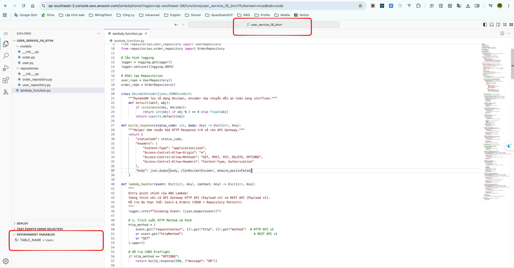
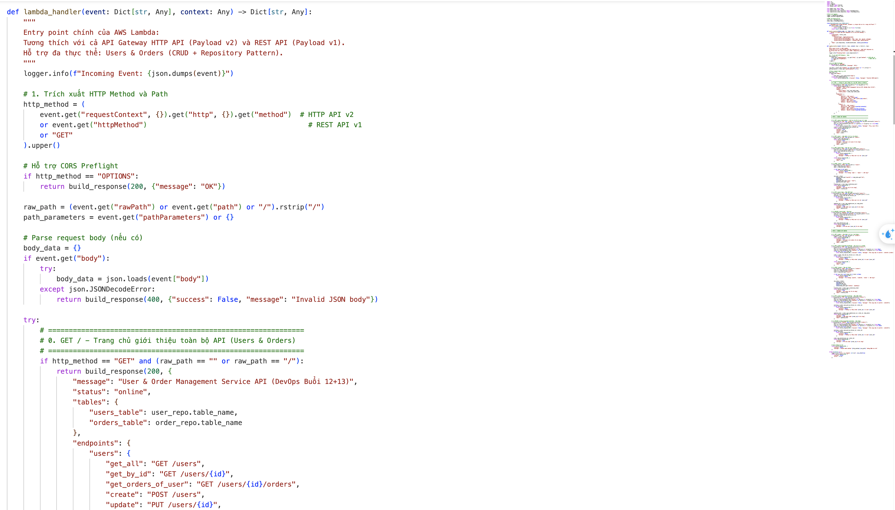
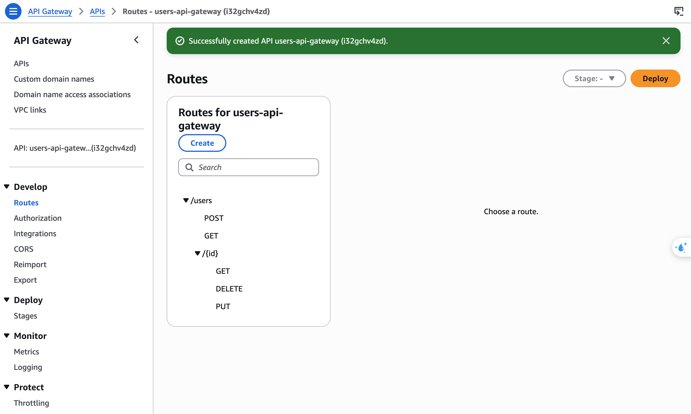

## 1. Link API Gateway Public

- **Endpoint kiểm tra danh sách Users (`GET /users`)**:
  ```text
  https://i32gchv4zd.execute-api.ap-southeast-2.amazonaws.com/users
  ```

- **Endpoint kiểm tra chi tiết user (`GET /users/{id}`)**:
  ```text
  https://i32gchv4zd.execute-api.ap-southeast-2.amazonaws.com/users/u1
  ```

---

## 2. Screenshots

### 2.1. VSCode trong Lambda & Lambda Env



---

### 2.2. Lambda Handler



---

### 2.3. Cấu hình API Gateway Routes (`users-api-gateway`)
> Danh sách các route đã tạo trên API Gateway (`GET /users`, `POST /users`, `GET /users/{id}`, `DELETE /users/{id}`, `PUT /users/{id}`) tích hợp trực tiếp tới Lambda `user_service_f8_btvn`.


